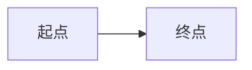

聚焦本 Part 的核心主题，概述这一阶段要掌握的关键能力与学习路径。

## Mermaid 图注与对齐用法

图注和图的对齐方式都写在代码块开头的 `%%` 指令行里。对齐只支持 left、center、right 三种值，不写时默认居中。

指令行必须紧贴代码块第一行，中间不能有空行。两条指令的先后顺序随意，各最多写一条。

### 对齐对照

| 指令 | 效果 |
| --- | --- |
| 不写 align | 图与图注均居中 |
| `%% align: left` | 图与图注均靠左 |
| `%% align: center` | 图与图注均居中 |
| `%% align: right` | 图与图注均靠右 |

省略 caption 指令时只输出图，不输出图注。