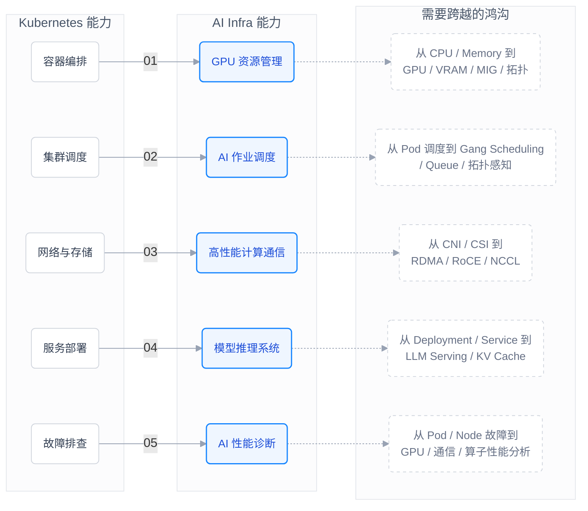
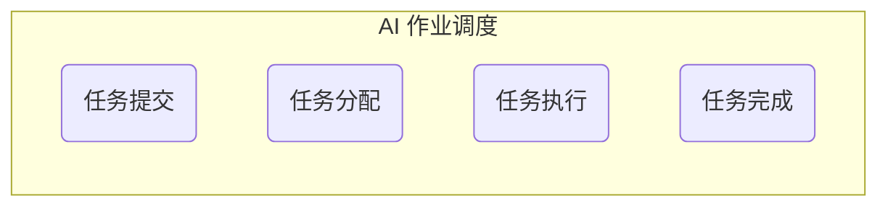

## 先说结论
SRE 转 AI Infra，已有的能力大部分不会浪费，但需要重新排一次优先级。真正要补的不是工具链，而是**对 GPU 资源特性的直觉**——哪些指标决定成败，哪些优化是无效劳动，哪些故障模式在传统系统里根本不会出现。

## Kubernetes 到 AI Infra
**必须跨越的 5 道技术鸿沟**

我们都知道Kubernetes 解决的是容器化工作负载的编排问题，而AI Infra 解决的是 AI 计算资源、分布式训练、模型推理和算力效率问题。 这两者并不是简单的技术栈升级，而是底层工程能力的扩展。 最大的变化是：你不能只关注 Pod 是否 Running，
还要理解 GPU 为什么没有跑满、训练为什么卡住、推理为什么延迟升高，以及整个集群的算力为什么没有得到有效利用。

### GPU 资源管理
> 从 Kubernetes Resource 到 GPU Computing

这是 K8s 工程师进入 AI Infra 最先需要补齐的能力。传统 Kubernetes 关注的是：
- CPU Requests / Limits
- Memory Requests / Limits
- Pod 调度与资源隔离
- Node Allocatable

**而AI Infra 还需要理解的是：**
- GPU 显存（VRAM）
- GPU SM 利用率
- GPU 显存带宽
- MIG / MPS
- NVLink / NVSwitch
- GPU Direct RDMA
- GPU 健康状态与 ECC 错误

以上两个最核心的一个认知变化就是：__Kubernetes 认为一个 GPU 是可分配资源，但 AI 任务真正关心的是 GPU 的计算能力、显存容量、显存带宽和 GPU 之间的通信能力__

例如：一个 Pod 成功申请了 8 张 GPU，不代表这 8 张 GPU 就能高效协同工作。 你需要进一步判断 GPU 拓扑、NUMA 亲和性、NVLink 连接情况等，那这些需要掌握的技能。

### AI作业的调度
> 从 Pod Scheduling 到 AI Workload Scheduling

Kubernetes 默认调度器主要解决 Pod 的资源分配问题。 但 AI 训练通常不是一个 Pod 的事情，而是多个 Worker 协同完成的分布式任务

例如：一个分布式训练任务可能需要：
- 4 台机器
- 每台机器 8 张 GPU
- 总共 32 张 GPU
- 多个 Worker 同时启动
- Worker 之间需要高速通信

画图：一个分布式训练任务的调度流程

## 哪些能力可以直接搬

**容量与成本。** SRE 最熟悉的容量规划、成本归因、SLO 定义，换到 AI Infra 依然成立，只是单位从 CPU 核时变成 GPU 卡时。

**故障复盘。** 一套成熟的 postmortem 流程，用来分析训练任务失败、显存溢出、checkpoint 损坏，方法论不用改。

**可观测性。** 指标体系、日志聚合、告警分级——容器时代怎么搭，GPU 时代照搭，只是要补上显存、SM 利用率、NVLink 带宽这些新维度。

## 哪些需要重新学

**单点成本意识。** 传统系统里一台机器挂了是"容量损耗"，GPU 集群里一张卡挂了可能是"整批任务重跑"。这会让 SRE 对"多副本"和"容错"的直觉失效——不是加个副本就解决了，而是要保证任务能从断点续上。

**散热与功耗。** GPU 集群的散热是真问题，机房功率密度、液冷、风扇曲线，这些在传统 SRE 里几乎不碰。

**调度语义。** K8s 的调度器是按 CPU/内存算的。GPU 调度要考虑拓扑、亲和性、显存碎片，这不是调参能解决的，是另一套模型。

**数据管道。** 训练的瓶颈经常不在计算，而在数据加载。SRE 熟悉的是服务链路，AI Infra 里要额外理解存储带宽、数据集缓存、预处理流水线。

## 过渡路径：三个台阶

**第一台阶：把 SRE 的纪律带进去。** 监控、告警、变更管理、容量台账。AI Infra 团队最缺的往往就是这套纪律——数据组擅长实验，不擅长兜底。这部分是 SRE 的主场。

**第二台阶：理解任务的生命周期。** 一次训练从排队、启动、checkpoint、失败重跑到完成，每一段的失败代价完全不同。知道哪里该设保护，比知道用哪个框架更重要。

**第三台阶：参与调度与成本模型。** 谁能把 GPU 的利用率、排队时长、任务优先级、成本分摊这几件事串成一个闭环，谁就真正进入了 AI Infra 的核心。

## 一个提醒

转型中最容易走偏的，是把自己变成"会用工具的运维"——装了几个新组件、跑了几个 demo 模型，就认为完成了转型。

真正的分水岭是能不能回答这个问题：**这个集群的每一块钱，是怎么变成有效产出的？** 能答上来，才算进去了。

## 最后

SRE 的核心从来不是某个系统，而是"在不确定中提供确定的下限"。AI Infra 恰好是一个不确定度更高的场景。

所以这不是一次转行，是一次把同一套方法论用到更难的地方。