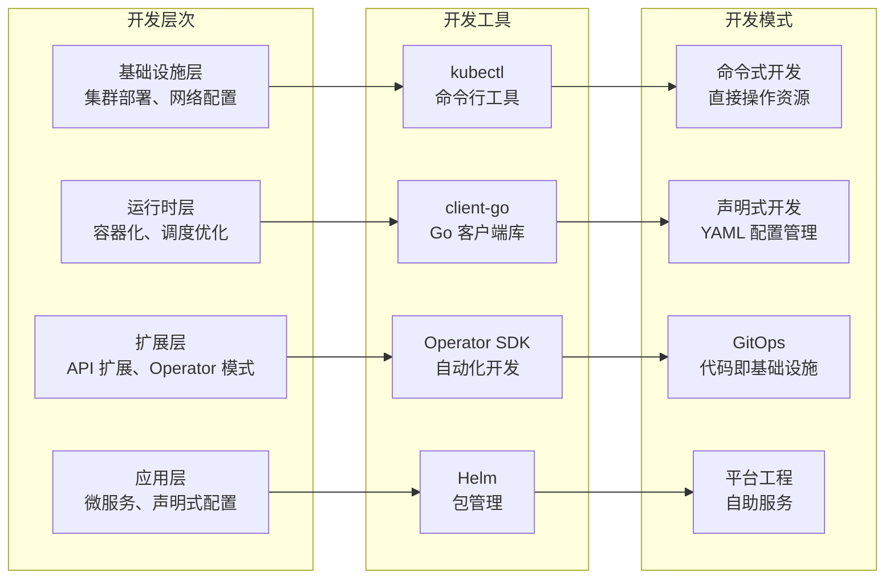

> Kubernetes 开发不仅是技术的革新，更是云原生思维与工程实践的深度融合之路。

Kubernetes 支持多种扩展方式，开发者可以通过自定义资源定义（CRD）、控制器、Admission Webhook、调度器扩展和网络插件（CNI）等机制，构建定制化的云原生解决方案。掌握这些开发模式和工具，有助于扩展 Kubernetes 能力，实现自动化和高效管理。

### Kubernetes 开发生态全景
Kubernetes 作为云原生应用的首选平台，为开发者提供了丰富的开发工具和扩展机制。从简单的应用部署到复杂的分布式系统管理，Kubernetes 开发涵盖了从基础设施到应用的全栈开发能力。

### 核心开发理念
Kubernetes 的开发理念贯穿声明式配置、控制器模式和可扩展架构，为应用的自动化和弹性管理奠定基础。

章节概述

本文全面介绍 Kubernetes 开发的核心理念、工具链、开发模式及最佳实践，帮助读者系统掌握 Kubernetes 应用和扩展开发的关键技术与方法。

SIG 和 WG

本文系统梳理 Kubernetes 社区组织架构、主要 SIG/WG 列表、参与路径及资源，帮助读者高效融入全球云原生生态。

配置开发环境

介绍如何在 macOS 上使用 Docker 环境编译 Kubernetes，包括环境配置、依赖安装和编译流程的详细说明。

client-go 示例

通过一个实战示例，介绍如何使用 client-go 库实现对 Kubernetes 集群中 Deployment 资源的镜像更新操作，涵盖代码实现、编译使用及监控排查等内容。

client-go informer

本文将以图文并茂的方式对 client-go 中的 informer 的源码进行深入分析，揭示其核心实现机制。

测试指南

介绍 Kubernetes 项目中的各种测试方法和最佳实践，涵盖单元测试、集成测试和端到端测试，帮助开发者构建高质量的 Kubernetes 组件。

Operator

深入了解 Kubernetes Operator 的原理、架构、应用场景和 2025 年最佳实践。

Lease 与领导者选举

讲解 coordination.k8s.io 的 Lease 对象在 Kubernetes 中的四种用途（节点心跳、控制面组件领导者选举、API Server 身份、自定义工作负载协调），client-go 领导者选举的工作原理与 LeaseDuration/RenewDeadline/RetryPeriod 参数调优，controller-runtime 中的开启方式，协调式领导者选举（CoordinatedLeaderElection，v1.33 Beta）如何让升级时由最旧版本当选，以及常见的脑裂与失效排障。

高级开发指南

本指南面向已经熟悉 Kubernetes 基础概念的开发者，旨在通过行业最佳实践和技术栈，帮助你构建生产级的云原生应用程序。

社区参与

本文介绍如何参与 Kubernetes 开源社区，包括社区治理结构、贡献方式、开发指南和相关资源，帮助开发者更好地融入 Kubernetes 生态系统。

Minikube

介绍如何安装配置 Minikube，以及常用的操作命令。