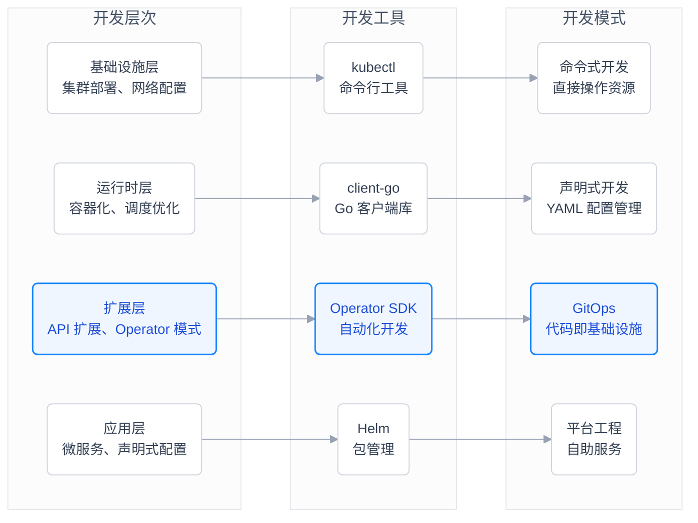
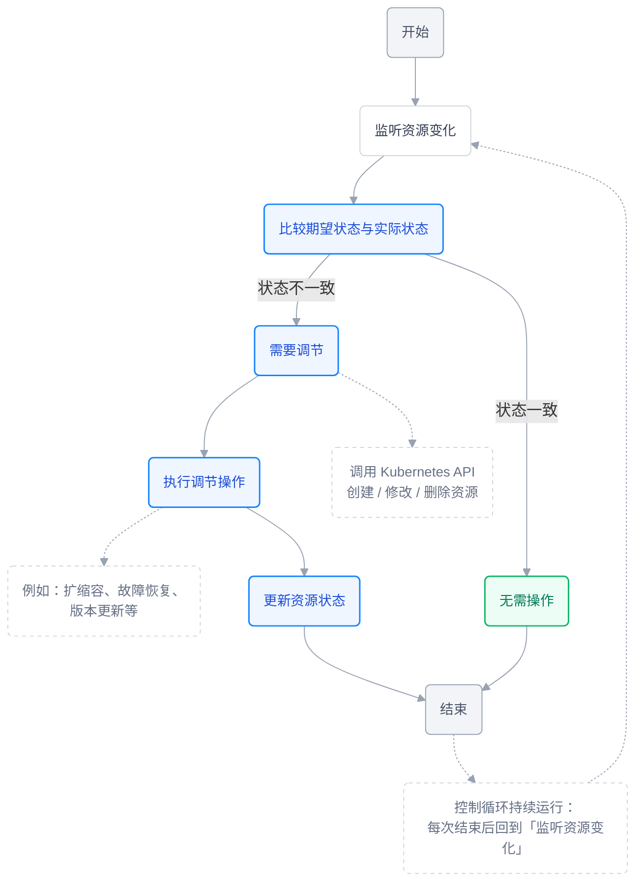

> Kubernetes 开发不仅是技术的革新，更是云原生思维与工程实践的深度融合之路。

Kubernetes 支持多种扩展方式，开发者可以通过自定义资源定义（CRD）、控制器、Admission Webhook、调度器扩展和网络插件（CNI）等机制，构建定制化的云原生解决方案。掌握这些开发模式和工具，有助于扩展 Kubernetes 能力，实现自动化和高效管理。

## Kubernetes 开发生态全景
Kubernetes 作为云原生应用的首选平台，为开发者提供了丰富的开发工具和扩展机制。从简单的应用部署到复杂的分布式系统管理，Kubernetes 开发涵盖了从基础设施到应用的全栈开发能力。



## 核心开发理念
Kubernetes 的开发理念贯穿声明式配置、控制器模式和可扩展架构，为应用的自动化和弹性管理奠定基础。

### 声明式配置

```yaml
# 声明式配置示例
apiVersion: apps/v1
kind: Deployment
metadata:
  name: my-app
spec:
  replicas: 3
  selector:
    matchLabels:
      app: my-app
  template:
    metadata:
      labels:
        app: my-app
    spec:
      containers:
      - name: app
        image: myapp:v1.0
        ports:
        - containerPort: 8080
```

+ 声明式与命令式开发的区别：

| 方面 | 声明式开发 | 命令式开发 |
| --- | --- | --- |
| 关注点 | 期望结果 | 执行步骤 |
| 优势 | 自愈能力，幂等性 | 精确控制，调试友好 |
| 使用场景 | 长期运行的服务 | 一次性任务，调试 |
| 工具链 | yaml配置，Helm | kubectl命令，脚本 |

### 控制器模式

Kubernetes 核心是**控制器循环(Controller Loop)**，控制器持续监控实际状态与期望管理状态的差异，实现了对集群中资源的自动管理和协调。



### 可扩展架构

Kubernetes 的可扩展性体现在 API、调度、网络和运行时等多个层面，支持多样化的企业需求。


### 开发工具链

Kubernetes 提供多样化的开发工具，覆盖命令行、SDK、自动化框架和包管理等场景

**kubectl - 开发者入口**
kubectl 是 Kubernetes 开发者的主要工具，支持资源管理、调试和监控
```shell
# 开发常用命令
kubectl create -f deployment.yaml    # 创建资源
kubectl apply -f deployment.yaml     # 声明式更新
kubectl get pods -w                  # 实时监控
kubectl logs -f deployment/my-app    # 查看日志
kubectl exec -it pod/my-pod -- /bin/bash  # 调试容器
kubectl port-forward svc/my-service 8080:80  # 端口转发
```
**client-go - Go 开发 SDK**
client-go 是 Kubernetes 官方的 Go 客户端库，适合自动化和扩展开发
```go
package main

import (
    "context"
    "fmt"
    metav1 "k8s.io/apimachinery/pkg/apis/meta/v1"
    "k8s.io/client-go/kubernetes"
    "k8s.io/client-go/rest"
)

func main() {
    // 创建客户端配置
    config, err := rest.InClusterConfig()
    if err != nil {
        panic(err.Error())
    }

    // 创建客户端
    clientset, err := kubernetes.NewForConfig(config)
    if err != nil {
        panic(err.Error())
    }

    // 列出所有 Pod
    pods, err := clientset.CoreV1().Pods("").List(context.TODO(), metav1.ListOptions{})
    if err != nil {
        panic(err.Error())
    }

    fmt.Printf("There are %d pods in the cluster\n", len(pods.Items))
}
```
### 开发框架

**Operator SDK - 自动化开发**
Operator SDK 简化了 Operator 的创建、测试与打包流程
```shell
# 初始化项目
operator-sdk init --domain example.com --repo github.com/example/my-operator

# 创建API
operator-sdk create api --group apps --version v1 --kind MyApp --resource --controller

# 构建和部署
make docker-build docker-push IMG=myregistry/my-operator:v1.0.0
make deploy IMG=myregistry/my-operator:v1.0.0
```

**Kubebuilder - 高级开发框架**
Kubebuilder 提供项目脚手架和代码生成，适合高级 Operator 开发。
```shell
# 初始化项目
kubebuilder init --domain example.com --repo github.com/example/my-controller
# 创建API
kubebuilder create api --group apps --version v1 --kind MyApp --resource --controller
# 运行测试
make test
```
### 开发模式演进
Kubernetes 开发模式经历了从传统单体到云原生、再到平台工程的演变。
图 4: 开发模式演进：从传统开发、云原生转型到平台工程

### 发展趋势
随着 AI/ML 原生集成和多云混合云架构的普及，Kubernetes 开发正迈向智能化和平台化。
图 5: AI/ML 原生集成：开发模式与 Kubernetes 支持的对应关系

**AI/ML 原生集成**
Kubernetes 支持 AI/ML 工作负载的模型服务、推理优化和分布式训练。

**多云和混合开发**
现代应用需要在多个云环境和混合基础设施上运行，提升弹性与可用性。
图 6: 多云和混合云开发：混合云场景、多云架构与开发工具


## SIG 和 WG
本文系统梳理 Kubernetes 社区组织架构、主要 SIG/WG 列表、参与路径及资源，帮助读者高效融入全球云原生生态。

## 配置开发环境

介绍如何在 macOS 上使用 Docker 环境编译 Kubernetes，包括环境配置、依赖安装和编译流程的详细说明。

## client-go 示例

通过一个实战示例，介绍如何使用 client-go 库实现对 Kubernetes 集群中 Deployment 资源的镜像更新操作，涵盖代码实现、编译使用及监控排查等内容。

## client-go informer

本文将以图文并茂的方式对 client-go 中的 informer 的源码进行深入分析，揭示其核心实现机制。

## 测试指南

介绍 Kubernetes 项目中的各种测试方法和最佳实践，涵盖单元测试、集成测试和端到端测试，帮助开发者构建高质量的 Kubernetes 组件。

## Operator 模式

深入了解 Kubernetes Operator 的原理、架构、应用场景和 2025 年最佳实践。

## Lease 与领导者选举

讲解 coordination.k8s.io 的 Lease 对象在 Kubernetes 中的四种用途（节点心跳、控制面组件领导者选举、API Server 身份、自定义工作负载协调），client-go 领导者选举的工作原理与 LeaseDuration/RenewDeadline/RetryPeriod 参数调优，controller-runtime 中的开启方式，协调式领导者选举（CoordinatedLeaderElection，v1.33 Beta）如何让升级时由最旧版本当选，以及常见的脑裂与失效排障。

### 高级开发指南

本指南面向已经熟悉 Kubernetes 基础概念的开发者，旨在通过行业最佳实践和技术栈，帮助你构建生产级的云原生应用程序。

### 社区参与

本文介绍如何参与 Kubernetes 开源社区，包括社区治理结构、贡献方式、开发指南和相关资源，帮助开发者更好地融入 Kubernetes 生态系统。

### Minikube
介绍如何安装配置 Minikube，以及常用的操作命令。

### Kind 集群