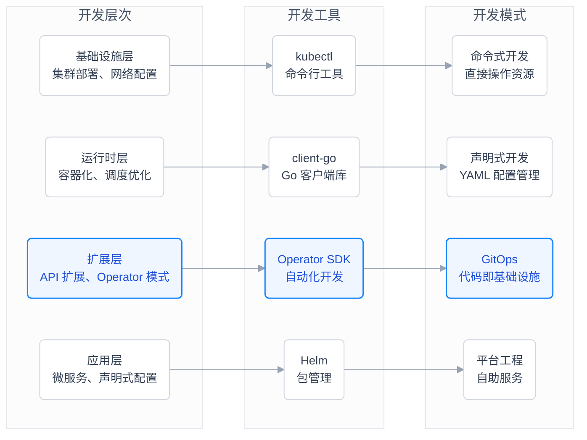
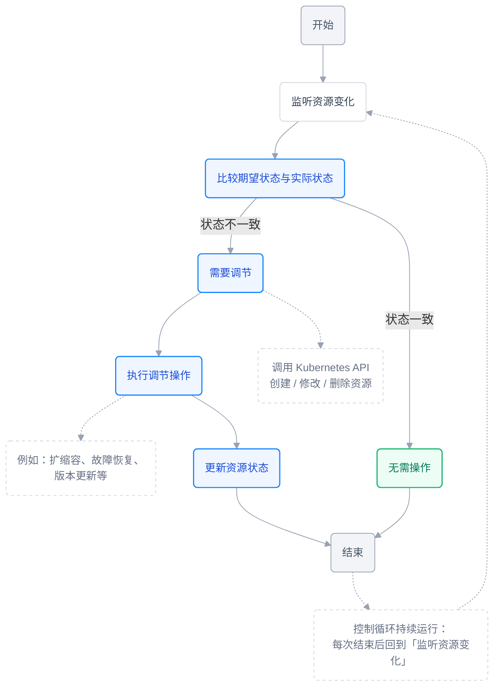
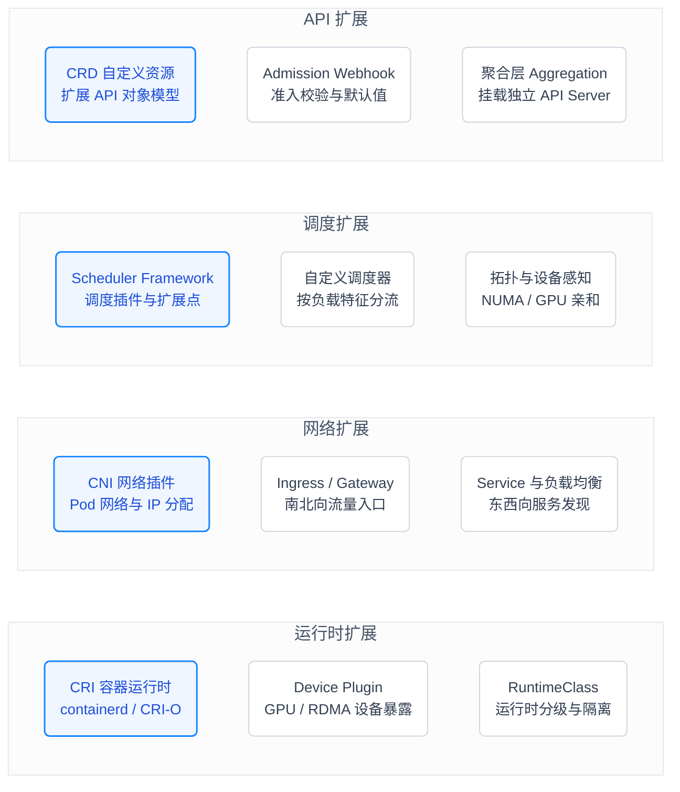
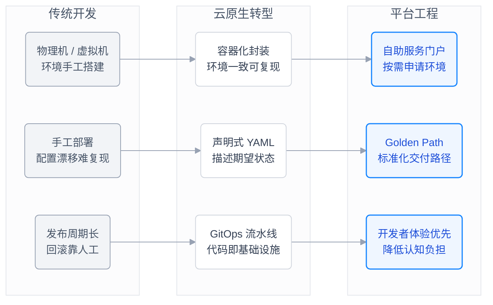
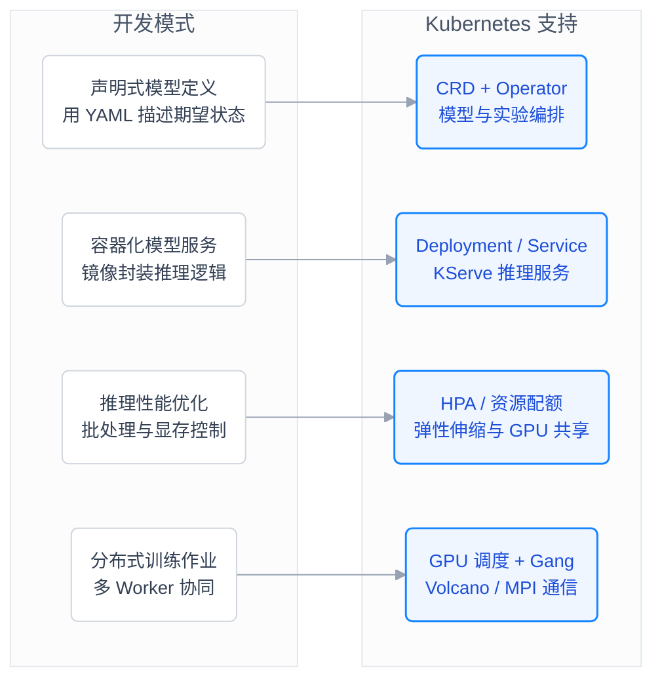
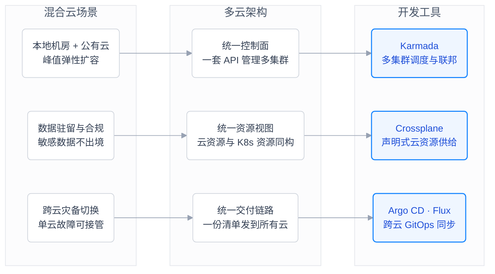
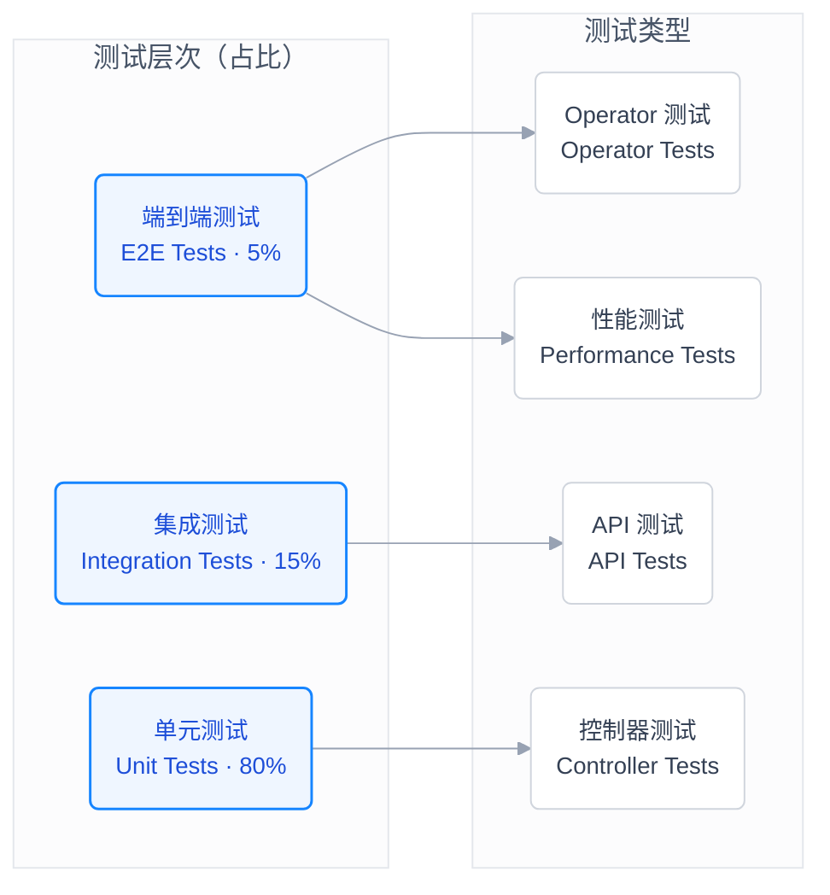
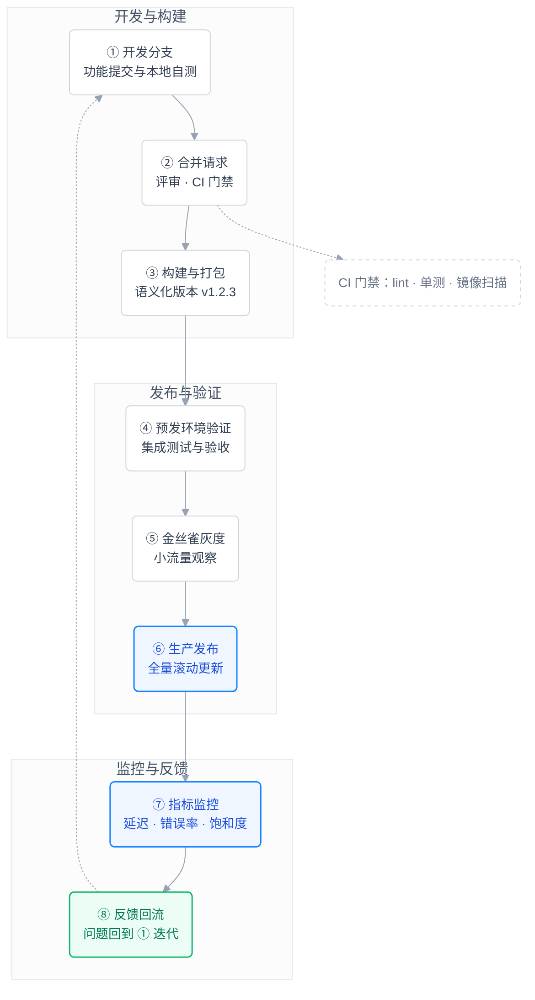

> Kubernetes 开发不仅是技术的革新，更是云原生思维与工程实践的深度融合之路。

Kubernetes 支持多种扩展方式，开发者可以通过自定义资源定义（CRD）、控制器、Admission Webhook、调度器扩展和网络插件（CNI）等机制，构建定制化的云原生解决方案。掌握这些开发模式和工具，有助于扩展 Kubernetes 能力，实现自动化和高效管理。

## Kubernetes 开发生态全景
Kubernetes 作为云原生应用的首选平台，为开发者提供了丰富的开发工具和扩展机制。从简单的应用部署到复杂的分布式系统管理，Kubernetes 开发涵盖了从基础设施到应用的全栈开发能力。



## 核心开发理念
Kubernetes 的开发理念贯穿声明式配置、控制器模式和可扩展架构，为应用的自动化和弹性管理奠定基础。

## 声明式配置

```yaml
# 声明式配置示例
apiVersion: apps/v1
kind: Deployment
metadata:
  name: my-app
spec:
  replicas: 3
  selector:
    matchLabels:
      app: my-app
  template:
    metadata:
      labels:
        app: my-app
    spec:
      containers:
      - name: app
        image: myapp:v1.0
        ports:
        - containerPort: 8080
```

+ 声明式与命令式开发的区别：

| 方面 | 声明式开发 | 命令式开发 |
| --- | --- | --- |
| 关注点 | 期望结果 | 执行步骤 |
| 优势 | 自愈能力，幂等性 | 精确控制，调试友好 |
| 使用场景 | 长期运行的服务 | 一次性任务，调试 |
| 工具链 | yaml配置，Helm | kubectl命令，脚本 |

## 控制器模式

Kubernetes 核心是**控制器循环(Controller Loop)**，控制器持续监控实际状态与期望管理状态的差异，实现了对集群中资源的自动管理和协调。



## 可扩展架构

Kubernetes 的可扩展性体现在 API、调度、网络和运行时等多个层面，支持多样化的企业需求。


## 开发工具链

Kubernetes 提供多样化的开发工具，覆盖命令行、SDK、自动化框架和包管理等场景

**kubectl - 开发者入口**
kubectl 是 Kubernetes 开发者的主要工具，支持资源管理、调试和监控
```shell
# 开发常用命令
kubectl create -f deployment.yaml    # 创建资源
kubectl apply -f deployment.yaml     # 声明式更新
kubectl get pods -w                  # 实时监控
kubectl logs -f deployment/my-app    # 查看日志
kubectl exec -it pod/my-pod -- /bin/bash  # 调试容器
kubectl port-forward svc/my-service 8080:80  # 端口转发
```
**client-go - Go 开发 SDK**
client-go 是 Kubernetes 官方的 Go 客户端库，适合自动化和扩展开发
```go
package main

import (
    "context"
    "fmt"
    metav1 "k8s.io/apimachinery/pkg/apis/meta/v1"
    "k8s.io/client-go/kubernetes"
    "k8s.io/client-go/rest"
)

func main() {
    // 创建客户端配置
    config, err := rest.InClusterConfig()
    if err != nil {
        panic(err.Error())
    }

    // 创建客户端
    clientset, err := kubernetes.NewForConfig(config)
    if err != nil {
        panic(err.Error())
    }

    // 列出所有 Pod
    pods, err := clientset.CoreV1().Pods("").List(context.TODO(), metav1.ListOptions{})
    if err != nil {
        panic(err.Error())
    }

    fmt.Printf("There are %d pods in the cluster\n", len(pods.Items))
}
```
## 开发框架

**Operator SDK - 自动化开发**
Operator SDK 简化了 Operator 的创建、测试与打包流程
```shell
# 初始化项目
operator-sdk init --domain example.com --repo github.com/example/my-operator

# 创建API
operator-sdk create api --group apps --version v1 --kind MyApp --resource --controller

# 构建和部署
make docker-build docker-push IMG=myregistry/my-operator:v1.0.0
make deploy IMG=myregistry/my-operator:v1.0.0
```

**Kubebuilder - 高级开发框架**
Kubebuilder 提供项目脚手架和代码生成，适合高级 Operator 开发。
```shell
# 初始化项目
kubebuilder init --domain example.com --repo github.com/example/my-controller
# 创建API
kubebuilder create api --group apps --version v1 --kind MyApp --resource --controller
# 运行测试
make test
```
## 开发模式演进
Kubernetes 开发模式经历了从传统单体到云原生、再到平台工程的演变。


## 发展趋势
随着 AI/ML 原生集成和多云混合云架构的普及，Kubernetes 开发正迈向智能化和平台化。


**AI/ML 原生集成**
Kubernetes 支持 AI/ML 工作负载的模型服务、推理优化和分布式训练。

**多云和混合开发**
现代应用需要在多个云环境和混合基础设施上运行，提升弹性与可用性。



## 开发环境配置
Kubernetes 支持本地和云端多种开发环境，便于快速迭代和测试。

### 本地开发环境
__Minikube - 单节点集群__
```bash
# 启动Minikube
minikube start --driver=docker --kubernetes-version=v1.37.1

# 启用插件
minikube addons enable ingress
minikube addons enable dashboard

# 获取集群信息
kubectl cluster-info
```
__Kind - 多节点本地集群__
```yaml

```
```shell
# 创建集群
kind create cluster --config kind-config.yaml --name my-cluster

# 加载镜像到集群
kind load docker-image my-app:latest --name my-cluster
```
### 云端开发环境
__GitHub Codespaces__
```json
// .devcontainer/devcontainer.json
{
  "name": "Kubernetes Development",
  "image": "mcr.microsoft.com/devcontainers/go:1.21",
  "features": {
    "ghcr.io/devcontainers/features/docker-in-docker:2": {},
    "ghcr.io/devcontainers/features/kubectl-helm-minikube:1": {}
  },
  "customizations": {
    "vscode": {
      "extensions": [
        "ms-kubernetes-tools.vscode-kubernetes-tools",
        "ms-vscode.vscode-json",
        "golang.Go"
      ]
    }
  },
  "postCreateCommand": "minikube start"
}
```
## 开发最佳实践
合理的代码组织和测试策略是高质量 Kubernetes 项目的基础
```text
├── api/
│   └── v1alpha1/          # API 定义
├── controllers/           # 控制器逻辑
├── config/               # 配置管理
│   ├── crd/             # CRD 定义
│   ├── rbac/            # RBAC 配置
│   └── manager/         # Manager 配置
├── hack/                # 构建脚本
├── internal/            # 内部包
├── pkg/                 # 可重用包
├── test/                # 测试代码
│   ├── e2e/            # 端到端测试
│   └── integration/    # 集成测试
├── Dockerfile          # 容器构建
├── Makefile           # 构建配置
├── go.mod             # Go 模块
└── main.go            # 程序入口
```
## 测试策略
测试分层有助于保障系统稳定性和可维护性。


## 版本管理和发布
采用语义化版本和标准发布流程，确保项目可维护和可追溯。
```shell
# Chart.yaml
apiVersion: v2
name: my-operator
description: A Kubernetes operator for managing MyApp
type: application
version: 1.2.3          # Chart 版本
appVersion: "v1.2.3"    # 应用版本
```



## 学习路径
Kubernetes 学习分为初学者、中级和高级三个阶段，建议循序渐进。

### 初学者路径
理解 Pod、Service、Deployment 的核心概念
掌握基本的 kubectl 命令和操作
学习 Kubernetes 资源的声明式配置
使用 Minikube 搭建开发环境

### 中级开发者路径
深入理解控制循环和调谐机制
学习 CRD 和自定义控制器的开发
使用 Operator SDK 构建自动化组件
掌握 CNI 和 CSI 的扩展机制

### 高级开发者路径
构建内部开发平台和自助服务
学习 Karmada 和 Crossplane 的使用
实施企业级安全策略和审计
掌握大规模集群的性能调优

## 社区和生态
Kubernetes 社区活跃，支持多种贡献和学习方式，助力开发者成长。

## 开源贡献
贡献路径涵盖文档、代码、测试和设计讨论，社区活动丰富。

## 学习资源
Kubernetes 提供了官方文档、开发工具和社区资源为学习 Kubernetes 提供坚实基础。

__官方文档__<br>
[Kubernetes 官方文档 - 完整的概念和 API 参考](https://kubernetes.io/docs/home/)<br>
[kubectl 文档 - 命令行工具使用指南](https://kubernetes.io/docs/reference/kubectl/overview/)<br>
[API 参考 - 详细的 API 规范](https://kubernetes.io/docs/reference/api/)<br>
__开发工具__<br>
[client-go - Go 客户端库](https://github.com/kubernetes/client-go)<br>
[sample-controller - 控制器示例](https://github.com/kubernetes/sample-controller)<br>
[kubebuilder - 开发框架手册](https://sigs.k8s.io/kubebuilder/)<br>
__社区资源__<br>
[Kubernetes Slack - 实时社区讨论](https://kubernetes.slack.com/)<br>
[Stack Overflow - 问题解答](https://stackoverflow.com/questions/tagged/kubernetes)<br>
[CNCF Landscape - 云原生生态全景](https://landscape.cncf.io/)<br>

## 总结
Kubernetes 开发是一个不断演进的领域，从简单的应用部署到复杂的平台工程，开发者需要掌握声明式配置、控制器模式、可扩展架构等核心理念。2025 年的 Kubernetes 开发正处于激动人心的阶段，随着 AI/ML 工作负载的普及、多云架构的成熟，以及平台工程理念的推广，开发者将迎来更多的机遇和挑战。通过系统性的学习和实践，开发者可以构建更加可靠、可扩展和智能的云原生应用，为数字化转型贡献力量。

## Reference
[Kubernetes 官方文档 - kubernetes.io](https://kubernetes.io/docs/home/)<br>
[kubectl 文档 - kubectl.docs.kubernetes.io](https://kubectl.docs.kubernetes.io/)<br>
[API 参考 - kubernetes.io](https://kubernetes.io/docs/reference/api/)<br>
[client-go - github.com/kubernetes/client-go](https://github.com/kubernetes/client-go)<br>
[sample-controller - github.com/kubernetes/sample-controller](https://github.com/kubernetes/sample-controller)<br>
[kubebuilder - book.kubebuilder.io](https://book.kubebuilder.io/)<br>
[Kubernetes Slack - slack.k8s.io](https://kubernetes.slack.com/)<br>
[Stack Overflow - stackoverflow.com](https://stackoverflow.com/questions/tagged/kubernetes)<br>
[CNCF Landscape - landscape.cncf.io](https://landscape.cncf.io/)<br>